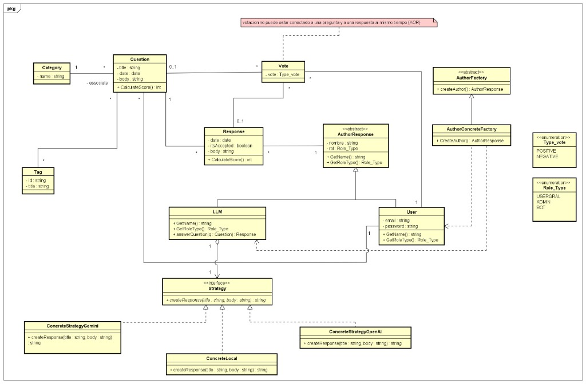

<div align="center">

# 💻 Trabajo Integrador — Ingeniería de Software 1
### Grupo 26


Repositorio correspondiente al Trabajo Práctico Integrador de la asignatura **Ingeniería de Software 1** de la **Licenciatura en Ciencias de la Computación** en la **Universidad Nacional de Río Cuarto (UNRC)**.

</div>

---

## 👥 Integrantes del Equipo

| Integrante | Usuario de GitHub |
| :--- | :--- |
| **Ghersinich, Matías Ezequiel** | [@GatiMhersi](https://github.com/GatiMhersi) |
| **González, Alexsandra** | [@AlexsandraGonzalez](https://github.com/AlexsandraGonzalez) |
| **Gutiérrez, Brisa Valentina** | [@BrisaGutierrez](https://github.com/BrisaGutierrez) |
| **Herrera, Milena** | [@MileHerrera](https://github.com/MileHerrera) |
| **Testa, Ignacio Agustín** | [@TestaIgna](https://github.com/TestaIgna) |

---

## 📚 Documentación del Proyecto (`/docs`)

Toda la documentación técnica, el diseño del sistema y las decisiones de arquitectura se encuentran en el directorio [`/docs`](./docs):

| Archivo | Descripción | Enlace Directo |
| :--- | :--- | :---: |
| **Diagrama de Clases UML** | Diseño estructural del sistema con sus clases, relaciones y patrones aplicados. | [📐 Ver imagen (`diagramaP.jpg`)](./docs/diagramaP.jpg) |
| **Justificación de Patrones** | Fundamentación técnica de los patrones de diseño implementados (*Factory Method* y *Strategy*). | [⚙️ Leer documento (`PatronesDeDiseñoJustificacion.txt`)](./docs/PatronesDeDise%C3%B1oJustificacion.txt) |

<details>
<summary>👁️ <b>Haz clic aquí para previsualizar el Diagrama de Clases UML</b></summary>
<br>
<div align="center">
  
</div>
</details>

---

## Instalación y Ejecución

### 1. Instalar dependencias y crear la base de datos
Por defecto el proyecto usa **SQLite local** (`DATABASE_URL=sqlite:///app.db`). Si querés personalizar las variables de entorno usando un archivo `.env` (copiado desde [`.env.example`](./.env.example)), podés pasarlo con `--env-file`:

```bash
# Instalar dependencias del proyecto
uv sync

# Aplicar todas las migraciones para inicializar la base de datos local
uv run alembic upgrade head
```

### 2. Levantar la aplicación web
```bash
uv run flask --app is1_trabajo_grupo26 run --debug
```

Luego abrir en el navegador `http://127.0.0.1:5000`.

> Por defecto usa respuestas locales; para activar la IA real, creá un `.env` desde [`.env.example`](./.env.example) con tu `GEMINI_API_KEY`.

### 3. Ejecutar tests
Los tests usan `TestingConfig` sobre SQLite en memoria (`sqlite:///:memory:`), por lo que no modifican la base de datos local:

```bash
uv run pytest -v
```

---

## Comandos útiles de Alembic (migraciones)

```bash
# Ver el estado actual de las migraciones en la base
uv run alembic current

# Generar una nueva migración automática a partir de los modelos en db.metadata
uv run alembic revision --autogenerate -m "descripcion del cambio"

# Revertir la última migración aplicada
uv run alembic downgrade -1
```

> **Nota:** Cada vez que agregues un nuevo modelo heredado de `db.Model`, asegurate de importarlo en [`src/is1_trabajo_grupo26/models/__init__.py`](./src/is1_trabajo_grupo26/models/__init__.py) para que `alembic revision --autogenerate` lo detecte.
