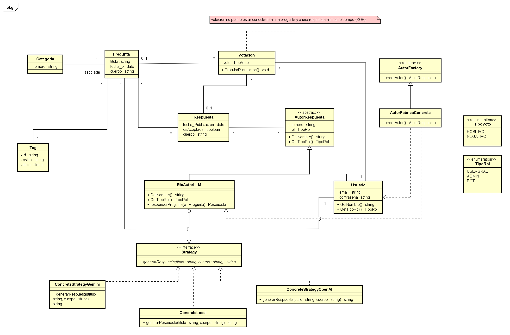

# 

# 

# \# 💻 Trabajo Integrador — Ingeniería de Software 1

# \### Grupo 26

# 

# !\[UNRC](https://img.shields.io/badge/UNRC-Ciencias%20de%20la%20Computaci%C3%B3n-005580?style=for-the-badge)

# !\[Materia](https://img.shields.io/badge/Asignatura-Ingenier%C3%ADa%20de%20Software%201-2ea44f?style=for-the-badge)

# !\[Estado](https://img.shields.io/badge/Estado-En%20Desarrollo-orange?style=for-the-badge)

# 

# Repositorio correspondiente al Trabajo Práctico Integrador de la asignatura \*\*Ingeniería de Software 1\*\* de la \*\*Licenciatura en Ciencias de la Computación\*\* en la \*\*Universidad Nacional de Río Cuarto (UNRC)\*\*.

# 

# 

# 

# \---

# 

# \## 👥 Integrantes del Equipo

# 

# | Integrante | Usuario de GitHub |

# | :--- | :--- |

# | \*\*Ghersinich, Matías Ezequiel\*\* | \[@GatiMhersi](https://github.com/GatiMhersi) |

# | \*\*González, Alexsandra\*\* | \[@AlexsandraGonzalez](https://github.com/AlexsandraGonzalez) |

# | \*\*Gutiérrez, Brisa Valentina\*\* | \[@BrisaGutierrez](https://github.com/BrisaGutierrez) |

# | \*\*Herrera, Milena\*\* | \[@MileHerrera](https://github.com/MileHerrera) |

# | \*\*Testa, Ignacio Agustín\*\* | \[@TestaIgna](https://github.com/TestaIgna) |

# 

# \---

# 

# \## 📚 Documentación del Proyecto (`/docs`)

# 

# Toda la documentación técnica, el diseño del sistema y las decisiones de arquitectura se encuentran en el directorio \[`/docs`](./docs):

# 

# | Archivo | Descripción | Enlace Directo |

# | :--- | :--- | :---: |

# | \*\*Diagrama de Clases UML\*\* | Diseño estructural del sistema con sus clases, relaciones y patrones aplicados. | \[📐 Ver imagen (`diagramaP.png`)](./docs/diagramaP.png) |

# | \*\*Justificación de Patrones\*\* | Fundamentación técnica de los patrones de diseño implementados (\*Factory Method\* y \*Strategy\*). | \[⚙️ Leer documento (`PatronesDeDiseñoJustificacion.txt`)](./docs/PatronesDeDise%C3%B1oJustificacion.txt) |

# 

# 

# 
👁️ <b>Haz clic aquí para previsualizar el Diagrama de Clases UML</b>

#  

# 

# &#x20; 

# 

# 

